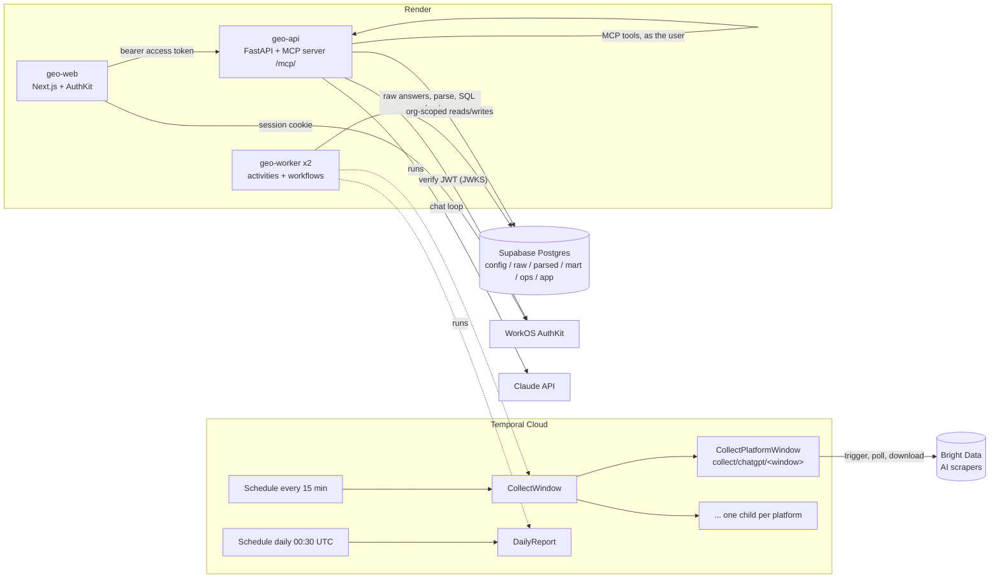

# Architecture

Mini GEO collects answers from six AI assistants every 15 minutes, turns them into one shape,
computes daily visibility in SQL, finds changes worth acting on, writes a customer report, and
serves a dashboards product with an AI chat. Nothing in the code is specific to Stripe or to
the 20 prompts: brands, prompts and platforms are configuration.

## System

### Data layers (Postgres schemas)

| Layer | Tables | Written by | Rule |
|---|---|---|---|
| `config` | platforms, prompts, brands, brand_categories, settings | seed from `data/*.csv` | what we track; no code change to add a brand or a prompt |
| `raw` | collection_runs, snapshots, answers | collection activities | untouched: `snapshots.body` is byte-for-byte what Bright Data returned; `answers.payload` is the per-answer record. Never updated. |
| `parsed` | answers, mentions, citations | Python parser | keyed by `(raw_answer_id, parser_version)` |
| `mart` | daily_visibility, daily_category_visibility, daily_citations, daily_platform_health, insights, reports | SQL functions (`002_etl.sql`, `004_category_grain.sql`), insights, report | recomputed per day from `parsed`; charts and the report read only from here |
| `ops` | dirty_days, pipeline_runs, collection_status (view) | pipeline | incremental state and run history |
| `app` | dashboards, charts | API / MCP | every row has `org_id` |

## Main decisions

**1. A window is the unit of exactly-once.** Each 15-minute window is identified by its start
time, derived from the Schedule's `TemporalScheduledStartTime` (not the wall clock, so a late
start still collects the right window). Two independent guards:
- Temporal: one child workflow per (platform, window) with id `collect/<platform>/<window>` and
  `REJECT_DUPLICATE`. A second trigger for the same window cannot start a second collection.
- Postgres: `raw.collection_runs` is unique on (window, platform) and `raw.answers` on
  (window, platform, prompt), with `ON CONFLICT DO NOTHING`. This holds even after Temporal's
  retention has expired, and if a whole workflow is replayed by hand.

`tests/test_collection_workflow.py` runs the real workflows against a Temporal dev server and
triggers one window twice: 6 runs, 120 answers.

**2. Overlap is allowed; lateness is bounded.** Bright Data's scrapers are asynchronous and can
take longer than 15 minutes. Windows are independent, so the schedule uses `ALLOW_ALL`: a slow
10:00 snapshot keeps polling while 10:15 starts. Each run has a deadline (50 minutes); past it
the run is recorded `timed_out` rather than collected late, because an answer fetched an hour
later is not that window's answer. The catch-up window is 14 minutes for the same reason: if the
workers are down, missed windows stay visible gaps, they are not back-filled with current answers.

**3. One snapshot per (window, platform).** All prompts for a platform go in one Bright Data
trigger: 6 API calls per window instead of 120, and one platform failing never blocks another.
The snapshot id is stored on the run before polling, so an activity retry polls the existing
snapshot instead of paying for a new one.

**4. Platform adapters are the only platform-specific code.** `geo/platforms/adapters.py` has one
class per platform that knows its record shape (field names, citation format, redirect URLs,
truncation flag). Subclasses self-register; seeding adds the platform row. The parser, SQL,
insights and app never branch on platform.

**5. Parser versions run side by side.** Parsed rows are keyed by parser version. A fixed parser
gets a new `PARSER_VERSION`; the pipeline parses every raw answer for it alongside the old rows,
and only when the backlog is empty does `ops.activate_parser_version()` switch the marts and mark
every day dirty. Metrics never mix two parsers, and the switch is a single transaction.

**6. Set-based ETL, incremental and idempotent by construction.** Parsing writes `ops.dirty_days`
in the same transaction as the parsed rows. `mart.refresh_dirty_days()` claims those days
(`FOR UPDATE SKIP LOCKED`, so concurrent runs don't collide) and recomputes each one completely from
`parsed` in SQL. Recompute-the-day rather than add-a-delta is what makes a second run, or a
re-delivered answer, unable to change a number. CI runs the pipeline twice; locally a checksum of
`mart.daily_visibility` is identical before and after a forced full refresh.

**7. Visibility is NULL, not 0, without real answers.** The grid is built from every
(day, platform, brand) we collected anything for, so a day of errors shows as empty rather than as a
collapse. Only `ok` answers count; errors, blocked pages, empty, cut-off and wrong-prompt answers are
kept in `parsed` and in `daily_platform_health` for data-quality checks.

**8. Insights gate on data quality first.** A day where a platform's share of real answers drops
is a collection problem: it is reported as such and excluded before change detection. See
[docs/METHOD.md](docs/METHOD.md).

**9. Charts are specs, not SQL.** A chart is a validated `ChartSpec` (metric, filters, grouping,
dates) evaluated against `mart` tables through a metric registry. Ratios are pooled
(Σ numerator / Σ denominator), so any chart matches the tables exactly. New metric = one registry
entry; new chart type = one entry plus its renderer.

**10. The chat acts as the user, through MCP only.** The Next.js server holds the WorkOS session
and forwards the user's access token. FastAPI verifies it on every request (JWKS signature,
expiry). The chat loop opens an MCP session to `/mcp/` with that same token; the MCP server is an
OAuth resource server that verifies it again and takes the organization from the token. Every
dashboard tool is scoped to that org in SQL. The free-form `run_query` tool runs inside a read-only
transaction as `geo_readonly`, a role that can read the metric tables and nothing in `app`, so even
hand-written SQL cannot reach another org's dashboards.

**11. Render instead of Azure/AWS.** The brief names Azure or AWS; no cloud account was issued for
this build, and Render was available. The deployable unit is one Docker image (API and worker) plus
a Node service, declared in `render.yaml`. Moving to Azure Container Apps or ECS Fargate is a new IaC
file, not a code change.

## Failure modes

| What fails | What happens | Where you see it |
|---|---|---|
| Bright Data slow | Polls every 20 s until the run deadline (50 min), then `timed_out`; next windows are unaffected | `raw.collection_runs`, `/status` |
| Bright Data 429 / 5xx | `RateLimited` → Temporal retries with exponential backoff (5 s → 2 min, 8 attempts) | Temporal UI, run `attempts` |
| Bright Data 4xx (bad token, dataset id) | Non-retryable; run marked `failed` with the error | `/status` `last_error` |
| Snapshot `failed` | Non-retryable; run `failed` | same |
| Worker crashes mid-run | Temporal resumes the workflow on the other replica; stored snapshot id prevents a second trigger | Temporal history |
| Trigger succeeds but the snapshot id is not saved (crash in between) | A retry triggers again: duplicate cost, no duplicate data (unique keys) | duplicate snapshots in Bright Data |
| Same window triggered twice | Child workflow ids collide → skipped; DB unique keys as backstop | `skipped_duplicates` in the workflow result |
| Answer delivered twice | `ON CONFLICT DO NOTHING` | `answers_received` vs `answers_inserted` |
| Prompts missing from a snapshot | Run collected, error notes "N prompts missing" | `/status` |
| Junk pages (login wall, captcha, HTML, rate-limit text) | Parsed as `not_answer`; excluded from visibility; days with many flagged as data issues | `mart.daily_platform_health`, report §4 |
| Workers down | Missed windows are gaps (no late back-fill beyond 14 min) | `runs_24h` < 96 per platform in `/status` |
| Database unavailable | Activities retry (6 attempts); then the run is failed in Temporal | Temporal UI |
| Parser bug found | New version parses beside the old; switch when complete; all days recomputed | `ops.pipeline_runs` |
| Two pipeline runs at once | Row locks with `SKIP LOCKED` on raw rows and dirty days; each day refreshed by one | — |
| Expired / forged session | 401 from FastAPI and MCP; AuthKit middleware refreshes tokens before expiry | — |
| Chat asks for another org's data | MCP tools filter by the token's org; SQL role cannot read `app` | `tests/test_api.py` |
| LLM refusal | Server-side fallback; otherwise a plain refusal message | API logs |

## What breaks first at 100× prompts (2,000 prompts)

That is 1.15 M answers a day. In order:

1. **Bright Data cost** (≈ 100 × the line below). A fixed 15-minute cadence for every prompt
   stops making sense; sample stable prompts hourly or daily and keep 15 minutes for the ones
   that move.
2. **Snapshot size and latency.** 2,000 inputs per snapshot take longer than a window and the
   download is large. Split each platform into chunks (one child workflow per chunk, same
   idempotency keys), and use Bright Data's completion webhook to signal the workflow instead of
   polling (cuts Temporal actions too).
3. **`raw.answers` growth** (~1.7 GB a day with snapshots). Partition `raw` by month on
   `window_start`, move payloads older than N days to object storage with a pointer, drop
   `raw.snapshots` after the per-answer rows are verified.
4. **Parse backlog query.** The anti-join over all raw rows gets slow; replace it with a parse
   queue written at ingest time (same pattern as `ops.dirty_days`).
5. **Day recompute.** Recomputing a whole day every 15 minutes becomes heavy; key dirtiness by
   (day, platform) and keep hourly partial aggregates.
6. **Insights.** Thousands of series make Bonferroni too strict; move to Benjamini–Hochberg (FDR)
   and add per-prompt-cluster series.

Workers, the API and the dashboards scale horizontally as they are; Temporal spreads tasks across
replicas.

## Running cost (current scale: 20 prompts × 6 platforms × 96 windows = 11,520 answers/day)

| Item | Estimate / month | Basis |
|---|---|---|
| Bright Data | ≈ $520 | 345,600 records × ~$1.50 per 1,000 (assumed pay-as-you-go rate; check the account's actual AI-scraper price) |
| Temporal Cloud | ≈ $100 | ~100 actions per window (6 children × trigger/poll/ingest + pipeline) ≈ 300 k actions; entry plan |
| Render | $28 | 2 × worker + API + web on Starter ($7 each) |
| Supabase | $25 | Pro plan; ~1 GB/month of raw data at this scale exceeds the free tier within weeks |
| Claude (chat) | ≈ $0.10–0.30 per chat request | Claude Opus 5.5, a handful of tool calls per request |
| **Total** | **≈ $675 + chat usage** | Bright Data is ~80 % |

## Extending

| To add | Change |
|---|---|
| An AI platform | One `PlatformAdapter` subclass in `geo/platforms/adapters.py` (dataset id, record shape). Seed adds the row. |
| A company / brands / prompts | Rows in `data/brands.csv`, `data/prompts.csv` (or `config.*`), then `geo seed`. Report: `geo report --brand <id>`. |
| A metric | One `Metric` in `geo/dashboards/charts.py` (and SQL in `002_etl.sql` if it needs a new mart column). |
| A chart type | One entry in `CHART_TYPES` and a renderer branch in `web/components/ChartCard.tsx`. |
| A chat tool | One `@mcp.tool()` function in `geo/mcp_server/server.py`. |
